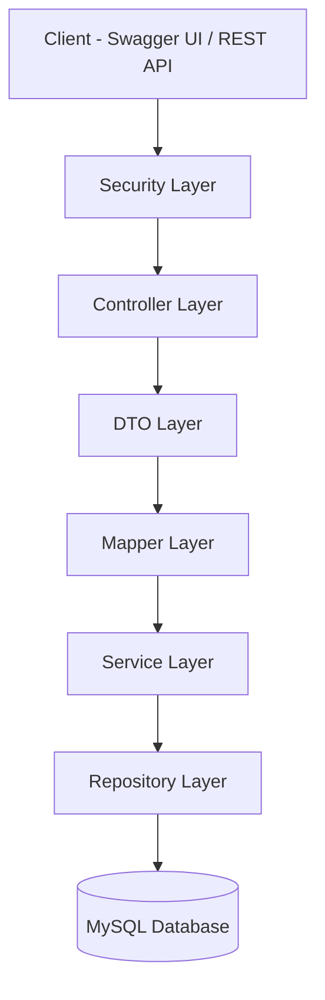

# Port Management System – Architecture

## Application Architecture

The Port Management System follows a layered architecture using Spring Boot.

## Architecture Components

### 1. Security Layer
- Spring Security
- JWT authentication
- BCrypt password encryption
- Role-based authorization

### 2. Controller Layer
Handles incoming HTTP requests and returns API responses.

### 3. DTO Layer
Transfers request and response data without exposing entity objects directly.

### 4. Mapper Layer
Converts Entity objects into DTOs and DTOs into Entity objects.

### 5. Service Layer
Contains application business logic and validation.

### 6. Repository Layer
Uses Spring Data JPA to communicate with the database.

### 7. Database Layer
MySQL stores application data, including users, ports, vessels, and berths.

## Technologies

Java | Spring Boot | Spring Security | JWT | Spring Data JPA | Hibernate | MySQL | Maven | Swagger
